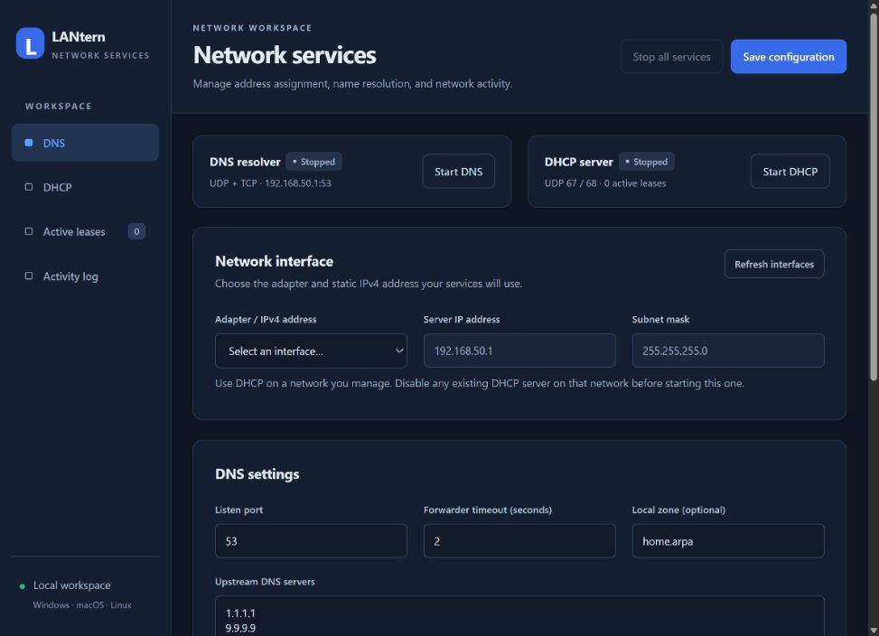

# LANtern · DNS & DHCP

A local DNS and DHCPv4 server written entirely with the Python standard library, with an English dark-mode browser console. Includes interface selection, independent service controls, local DNS records, upstream forwarding, DHCP options and reservations, persistent leases, and a live activity log.

**No installation. No third-party packages. Start with `python3 lantern.py`.**



## Features

- Select a network adapter and its existing IPv4 address.
- Start and stop DNS and DHCP independently.
- Create local DNS records and configure upstream DNS servers.
- Configure DHCP address pools, leases, reservations, and custom options.
- Operate an isolated network without advertising a gateway.
- Inspect active leases and filter, search, pause, or export the live log.
- Save settings, import/export configuration, and retain confirmed leases across restarts.

## Contents

- [Requirements](#requirements)
- [Run directly with Python 3](#run-directly-with-python-3)
- [Configure an isolated local network](#configure-an-isolated-local-network)
- [DNS](#dns)
- [DHCP](#dhcp)
- [Changes, logs, and storage](#changes-logs-and-storage)
- [Project files](#project-files)
- [Troubleshooting](#troubleshooting)
- [Validation and limitations](#validation-and-limitations)

## Requirements

- Python **3.10 or later**. No pip packages, package manager, or virtual environment required.
- Windows 10 version 1803 or later, Windows 11, macOS, or Linux.
- A working connection to an existing Wi-Fi or Ethernet network and a **static IPv4 address** on the server adapter.
- Administrator/root privileges for the standard ports and interface binding on macOS/Linux. Windows may require an elevated terminal and a firewall rule.
- Firewall access for DNS TCP/UDP 53 and DHCP UDP 67/68 on the chosen adapter.

The tool does not create an access point or configure NAT, routing, or internet sharing. The server itself must have an address before starting DHCP and cannot obtain its address from its own DHCP service.

## Run directly with Python 3

Extract the ZIP and open a terminal in the directory containing `lantern.py`:

```sh
python3 lantern.py
```

That is the complete startup command. There is no installation step and no dependency download. Only `lantern.py` is needed to run the application. The accompanying documents, sample configuration, and preview are optional. On Windows, use `py -3 lantern.py` or `python lantern.py` if that is how Python 3 is installed.

Open the **Console URL printed in the terminal**. The default is `http://127.0.0.1:8080`. If that port is blocked or occupied, LANtern tries 8090, 18080, and then an available port. Keep the terminal open. Press **Ctrl+C** to quit and close both services. DNS and DHCP are initially stopped; start them from the console.

On macOS/Linux, the standard service ports and DHCP interface binding normally require `sudo python3 lantern.py`. On Windows, open an administrator terminal if permissions prevent startup. The console itself only requires an ordinary local port.

Optional settings:

```sh
python3 lantern.py --ui-port 8090 --data-dir ./my-data
python3 lantern.py --open-browser
```

| Argument | Purpose |
| --- | --- |
| `--ui-port PORT` | Require a specific console port. Default: 8080 with automatic fallback when this argument is omitted. |
| `--data-dir PATH` | Store configuration and leases in this directory. Default: `data` next to `lantern.py`. |
| `--open-browser` | Open the console in the default browser after startup. |
| `--help` | Display command-line help and exit. |

An explicitly requested port is used exactly; it is not silently changed if busy. The console is restricted to `127.0.0.1` and can only be reached on the computer running the application.

## Configure an isolated local network

1. Assign the server a static address, for example `192.168.50.1` with subnet mask `255.255.255.0`.
2. Choose that adapter/address under **Network interface**.
3. Under **DHCP**, use pool `192.168.50.100`–`192.168.50.200`, lease duration `3600`, and client DNS server `192.168.50.1`. Leave **Gateway / router** empty for a local-only network.
4. Under **DNS**, use port `53`. Add a record such as `device.home.arpa`, type `A`, value `192.168.50.10`, TTL `300`.
5. Leave upstream DNS servers empty for offline use. Otherwise enter reachable upstream addresses, such as `1.1.1.1`. Forwarding uses the operating system routing table and can use another internet-connected adapter.
6. Click **Save configuration**, then **Start DNS** and **Start DHCP**.
7. Configure other devices on the same network to use DHCP and reconnect or renew their leases.

`example-config.json` is an importable template. Adjust the interface name and addresses to your network. It is not loaded automatically.

Run only one DHCP server on the network. Place other static devices outside the dynamic pool or reserve their addresses. The tool avoids its own duplicate allocations and handles DHCPDECLINE, but does **not actively probe for external static addresses with ARP or ping**.

## DNS

- DNS listens on the selected IPv4 address over both UDP and TCP. Its port is configurable; clients receiving this server through DHCP require port 53.
- Supported local records: A, AAAA, CNAME, TXT, MX, PTR, plus simple wildcard names such as `*.devices.home.arpa`.
- Use complete names. A trailing dot is optional. `home.arpa` is the default local zone; `.local` is avoided because it is used for multicast DNS.
- A/AAAA values are addresses. CNAME/PTR values are full target names. MX values use priority and target, such as `10 mail.home.arpa`. Enter TXT values without extra quotation marks.
- Multiple records per name are supported. A CNAME name may have only one CNAME record and no other record types.
- Local records take priority. Existing names with a missing record type return an empty successful answer. Unknown names within the local zone return NXDOMAIN and are not forwarded.
- Up to four upstream servers are tried in order. Use one IP per line, optionally with a port: `192.168.1.1:5353` or `[2606:4700:4700::1111]:53`.
- Forwarding validates the transaction ID and question, accepts UDP responses only from the connected upstream, and retries truncated responses over TCP.
- No upstream configured: external names return REFUSED. All upstreams failing: SERVFAIL. There is no local DNS cache.

## DHCP

DHCPv4 handles DISCOVER/OFFER, REQUEST/ACK/NAK, renewal, RELEASE, DECLINE, and INFORM for directly connected clients. Relay agents and DHCPv6 are not supported. Bootstrap replies use broadcast; renewals can use unicast.

Choose a pool within the server subnet and a lease duration from 120 to 2,592,000 seconds. Gateway, advertised DNS servers, and domain are optional. Server, gateway, and advertised DNS addresses are excluded from dynamic allocations.

Reservations map a MAC address to a host address in the same subnet, inside or outside the pool. Use the client's actual MAC address for this network; a private Wi-Fi address may differ from the hardware address. A stable private address can also be reserved.

| Option | Setting |
| --- | --- |
| 1 | Subnet mask of the selected adapter |
| 3 | Gateway; omitted when empty |
| 6 | Client DNS server list; may be empty |
| 15 | Domain; may be empty |
| 51 | Lease duration |
| 54 | Server IP address |
| 58 / 59 | Renewal at 50% / rebinding at 87.5% of lease duration |

Examples of custom options:

| Code | Type | Value | Purpose |
| --- | --- | --- | --- |
| 42 | ipv4 | 192.168.50.20 | NTP server |
| 66 | text | 192.168.50.30 | TFTP server name |
| 67 | text | boot.ipxe | Boot filename |
| 26 | uint16 | 1500 | Interface MTU |
| 43 | hex | 01 04 c0 a8 32 01 | Vendor-specific bytes |

Custom types are `text`, `hex`, `ipv4`, `uint8`, `uint16`, and `uint32`. Separate multiple IPv4 addresses with commas. Core options cannot be overridden through custom options. Options that do not fit the client packet-size limit are omitted and logged. DHCP option overload is not supported.

Interface isolation uses `IP_BOUND_IF` on macOS, `SO_BINDTODEVICE` on Linux, and an `IP_IFLIST` receive allow-list plus `IP_UNICAST_IF` on Windows. Windows adapter aliases are mapped with the native interface API. If isolation cannot be configured, DHCP does not start. Windows also uses exclusive port binding.

## Changes, logs, and storage

DNS and DHCP can be stopped independently. To save edits, stop both services, save, and restart the services you need. Stopping DNS displays a warning if running DHCP still advertises its address. Existing clients retain their settings until they renew their leases.

The activity log updates every second. Filter by service or search text, pause the view, or export a copy. The most recent 2,000 events are stored in memory; logs are not automatically persisted.

The default `data` directory contains:

- `config.json`: the last saved configuration.
- `leases.json`: confirmed leases and DECLINE quarantines, separated by interface/subnet.

Do not delete active lease data. Confirmed leases survive restarts; invalid lease files block DHCP startup to protect existing allocations. Configuration import/export is available in the console. Existing user-defined names and operating-system adapter names are preserved.

## Project files

The release contains one application source file and four supporting files:

```text
lantern.py             # Complete application, including the embedded web UI
README.md              # Setup, configuration, and troubleshooting guide
example-config.json    # Optional importable sample network configuration
test-report.json       # Validation summary and practical limitations
preview.png            # Dark-mode interface preview
```

DNS, DHCP, packet handling, adapter discovery, configuration, logging, the local web server, HTML, CSS, and JavaScript are all included in `lantern.py`. No separate Python modules or web assets are required. There is no package installation step.

The `data` directory is created when configuration or lease information is saved. Runtime configuration and active leases are not included in the release ZIP. The example configuration is optional and is never loaded automatically.

## Troubleshooting

- **Console unavailable:** start `python3 lantern.py`, keep it running, and open the printed URL. If a fixed port is blocked, use `--ui-port 8090` or omit the option for automatic fallback. `127.0.0.1` refers to the current computer.
- **Access denied:** use `sudo python3 lantern.py` on macOS/Linux; on Windows, try an administrator terminal and check firewall permissions.
- **Service port busy:** check other DNS/DHCP services, including internet sharing. DHCP requires UDP 67. The local DNS server advertised by DHCP must use port 53.
- **Interface inactive:** assign a static IPv4 address, refresh the interface list, and choose the matching address.
- **No DHCP requests logged:** check adapter selection, client network, firewall, and access point broadcast forwarding. Client isolation may prevent delivery.
- **Local DNS works but external names fail:** check upstream reachability from the server. An isolated network needs another connection for external DNS.
- **Wi-Fi still disconnects:** radio, authentication, and access point problems must be diagnosed separately from DHCP/DNS.

